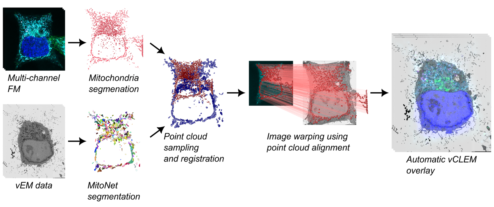
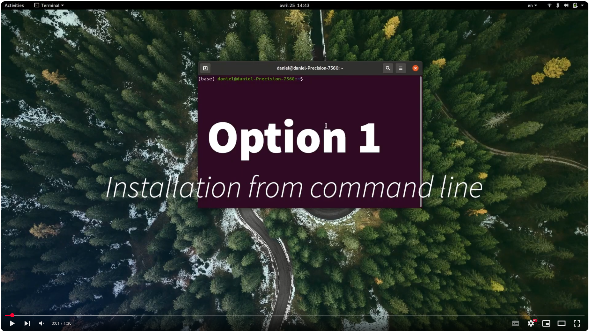
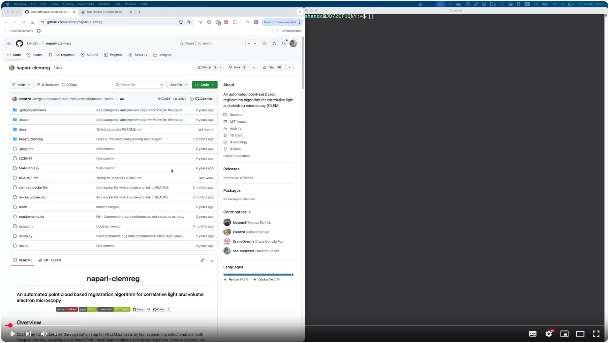
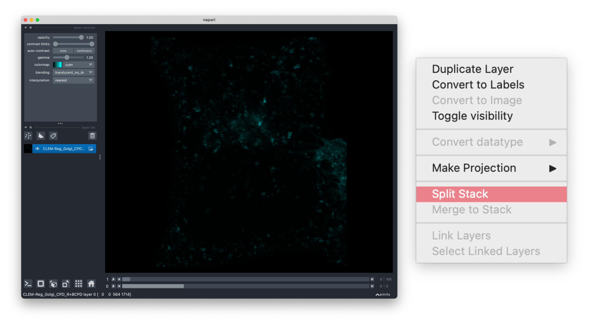
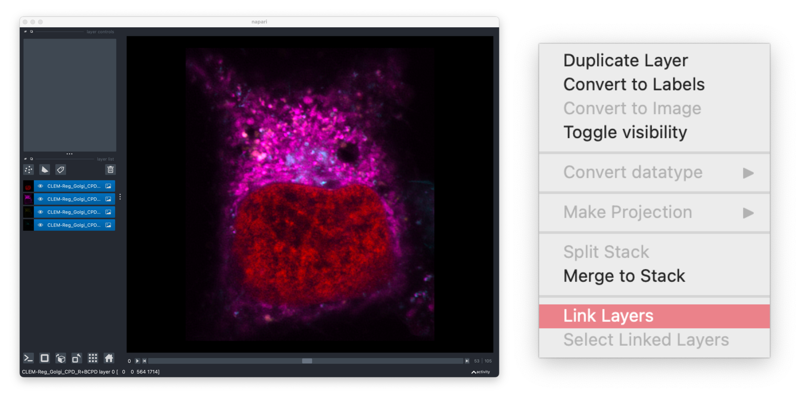

<h1 align="center">napari-clemreg</h1>

<p align="center"><b>Automated point cloud-based registration for volume correlative light and electron microscopy</b></p>

<p align="center">
    <a href="https://www.nature.com/articles/s41592-025-02794-0"></a>
    <a href="https://github.com/krentzd/napari-clemreg/actions/workflows/test.yml"></a>
    <a href="https://pypi.org/project/napari-clemreg"></a>
    <a href="https://pypistats.org/packages/napari-clemreg"></a>
    <a href="https://github.com/krentzd/napari-clemreg/blob/main/LICENSE"></a>
</p>

CLEM-Reg automates the registration of volume CLEM (vCLEM) datasets. It segments mitochondria in both the fluorescence (FM) and electron microscopy (EM) volumes, samples point clouds from the segmentations, registers them, and uses the result to warp the FM volume onto the EM volume.



The code as published in Nature Methods is tagged [`v1.0.0-nature-methods`](https://github.com/krentzd/napari-clemreg/tree/v1.0.0-nature-methods).

## Installation

napari-clemreg needs **Python 3.11 or newer**. Install it into a fresh environment, together with napari:

```
conda create -n clemreg python=3.11
conda activate clemreg
pip install "napari[all]" "napari-clemreg[segment-flow]"
napari
```

The `segment-flow` extra enables the default EM segmentation backend, which needs a few more tools on your system (see [EM segmentation](#em-segmentation)). Leave it out if you only want to start from an existing EM segmentation.

**Windows:** if napari-clemreg fails with `ImportError: DLL load failed while importing pybind`, that's `open3d`, a dependency. It needs the [Microsoft Visual C++ Redistributable](https://aka.ms/vs/17/release/vc_redist.x64.exe) and a GPU with OpenGL 4.1 or newer, so it won't work in a virtual machine or a remote desktop without GPU passthrough.

[](https://youtu.be/ZN68q9OU59s)

### From source

With [pixi](https://pixi.sh/) (Apple-silicon macOS, and Linux with glibc 2.31 or newer), one command sets up everything, including Nextflow and a JDK:

```
git clone https://github.com/krentzd/napari-clemreg.git
cd napari-clemreg
pixi run napari
```

Run the tests with `pixi run -e test test`, or `pixi run -e test test-slow` to include the slow tests that download the sample data. Elsewhere, use `pip install -e ".[segment-flow]" pyqt6` in a Python 3.11+ environment.

### Docker

The Docker image contains napari, napari-clemreg and everything the default EM segmentation needs. Build it from a clone of this repository:

```
docker build -t clemreg --target clemreg -f clemreg.dockerfile .
docker run --rm -e DISPLAY=$DISPLAY --net=host clemreg
```

- Add `--gpus=all` to use an NVIDIA GPU. This needs the [NVIDIA Container Toolkit](https://docs.nvidia.com/datacenter/cloud-native/container-toolkit/latest/install-guide.html).
- Add `-v /path/to/data:/data` to make a folder of your data available inside the container.
- Without an X server (for example on macOS), build the `clemreg_xpra` target instead. Run it with `docker run --rm -p 9876:9876 clemreg_xpra`, then open http://localhost:9876 in a browser.

[](https://youtu.be/2GRB99UlP6g)

## Usage

Open **Plugins → napari-clemreg → Run registration**. CLEM-Reg has five steps:
1. EM segmentation
2. FM segmentation
3. point cloud sampling
4. point cloud registration
5. image warping

**Register** runs them all. Each parameter section also has a **Run this step** button, which runs just that step on the layers in the section's inputs. When a step finishes, its output fills the next section's input, highlighted in amber. So you can step through the pipeline, or start partway through from layers you already have.

**Inputs**
- **Fluorescence Microscopy Image (FM)** and **Electron Microscopy Image (EM)**: 3D greyscale volumes. The FM image is warped onto the EM image.
- **Pixel sizes**: filled in from each image's metadata. Check them, and correct them if the metadata is missing or wrong.
- **Mask ROI** (optional): a Shapes layer with a single shape that limits FM segmentation to a region. You can also limit it to a range of slices.
- **Registration Algorithm**:
  - `Rigid CPD` (default, fastest);
  - `Affine CPD`;
  - `BCPD` (non-rigid, slowest).

**Parameter sections**
1. **EM Segmentation**: the backend that runs MitoNet (see [EM segmentation](#em-segmentation)).
2. **LoG Segmentation**: FM segmentation.
   - **Sigma** and **Threshold**: the Laplacian of Gaussian filter and the threshold applied after it.
   - An optional size filter removes objects outside a percentile range of volumes.
3. **Point Cloud Sampling**
   - **Sampling Frequency**: roughly the percentage of segmentation-edge points kept. Higher values give more points: more detail, but slower.
   - **Sigma**: the Canny edge filter's sigma.
4. **Point Cloud Registration**
   - **Voxel Size**: the grid the point clouds are downsampled onto. Larger values give fewer points and are faster.
   - **Maximum Iterations**: if too low, the registration may not converge.
   - **Image Warping**, inside this section, because this step's button also warps the FM image:
     - **Interpolation Order**.
     - **Output Pixel Size**: `Native LM resolution` (default) keeps the FM pixel size and places the result over the EM image. `EM pixel grid (legacy)` resamples it onto the EM grid.
     - **Approximate Grid** and **Sub-division Factor** (BCPD only): control the warp's resolution and the size of the chunks it's applied in.

**Output options**
- **Visualise Intermediate Results**: adds each step's segmentations and point clouds to the viewer.
- **Registration direction**: `FM → EM` (default) or `EM → FM`.
- **Save parameters** and **Parameters from JSON** don't work yet.

[](https://youtu.be/ud3zTLgl8Ks)

### EM segmentation

Mitochondria in the EM volume are segmented with [MitoNet](https://github.com/volume-em/empanada). By default, MitoNet runs through the Francis Crick Institute's [AI OnDemand](https://franciscrickinstitute.github.io/aiod_docs/) Segment-Flow pipeline, in its own isolated environment. It needs:
- the `segment-flow` extra (`pip install "napari-clemreg[segment-flow]"`);
- [Nextflow](https://www.nextflow.io/) and [Conda](https://docs.conda.io/) on `PATH`;
- a JDK, version 17–21. Newer JDKs fail with `Unsupported class file major version`. If your default JDK is newer, set `JAVA_HOME`.

The first run downloads and builds the model's environment (cached under `~/.nextflow/aiod`), which can take several minutes. Progress is printed in the terminal.

The alternative backend, `MitoNet (empanada-dl)`, runs the model inside napari. Its dependency `empanada-dl` can't currently be installed on Python 3.11 or newer.

**No GPU, or no Segment-Flow?** Open **File → Open Sample → napari-clemreg → EM Mask (precomputed, no GPU needed)**. It's an EM segmentation of the sample data, so you can start from the **Point Cloud Sampling** step.

### Registering several FM channels

1. Right-click the multichannel FM layer and choose **Split Stack**.
   
2. Select all the channel layers, right-click and choose **Link Layers**.
   
3. Choose the channel that shows mitochondria as the **Fluorescence Microscopy Image (FM)**. All linked channels are warped.

## Sample data

**File → Open Sample → napari-clemreg** has the benchmark dataset (a binned version of EMPIAR-10819) from two sources. Both give the same five layers: the EM volume at 20 nm, and four FM channels.

- **Sample Benchmark Data** downloads about 600 MB from [Zenodo](https://zenodo.org/records/7936982) the first time, then loads it from a local cache.
- **Sample Benchmark Data (OME-Zarr, streamed from the BioImage Archive)** streams the data from [S-BIAD4355](https://www.ebi.ac.uk/biostudies/bioimages/studies/S-BIAD4355) as you use it, and stores nothing on disk.
  - Opening it takes 10–15 seconds, during which napari doesn't respond.
  - It needs a network connection throughout.
  - The EM volume's contrast differs slightly from the Zenodo copy.

## Datasets

The datasets used in the paper:

| Dataset | EM | FM |
|---|---|---|
| EMPIAR-10819 | [EMPIAR-10819](https://www.ebi.ac.uk/empiar/EMPIAR-10819/) | [S-BSST707](https://www.ebi.ac.uk/biostudies/bioimages/studies/S-BSST707) |
| EMPIAR-11537 | [EMPIAR-11537](https://www.ebi.ac.uk/empiar/EMPIAR-11537/) | [S-BSST1075](https://www.ebi.ac.uk/biostudies/bioimages/studies/S-BSST1075) |

## How to cite

```bibtex
@article{krentzel2025clem,
  title={CLEM-Reg: an automated point cloud-based registration algorithm for volume correlative light and electron microscopy},
  author={Krentzel, Daniel and Elphick, Matou{\v{s}} and Domart, Marie-Charlotte and Peddie, Christopher J and Laine, Romain F and Shand, Cameron and Henriques, Ricardo and Collinson, Lucy M and Jones, Martin L},
  journal={Nature Methods},
  pages={1--12},
  year={2025},
  publisher={Nature Publishing Group US New York}
}
```

## License

napari-clemreg is free and open source software, distributed under the [MIT license](LICENSE).
