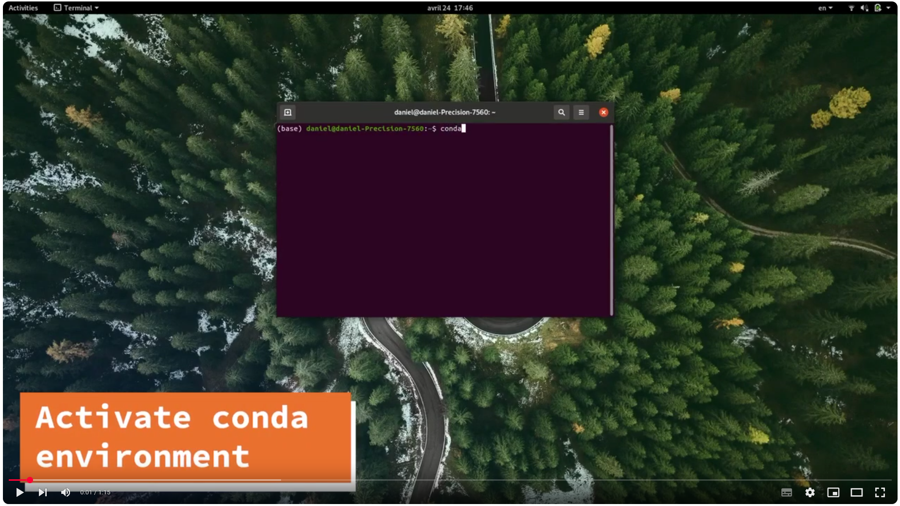

<h1 align="center">napari-clemreg</h1>

<p align="center">
    <a href="https://www.nature.com/articles/s41592-025-02794-0"></a>
    <a href="https://github.com/krentzd/napari-clemreg/actions/workflows/test.yml"></a>
    <a href="https://pypi.org/project/napari-clemreg"></a>
    <a href="https://github.com/krentzd/napari-clemreg/blob/main/LICENSE"></a>
</p>

A napari plugin that automatically registers volume correlative light and electron microscopy (vCLEM) data. CLEM-Reg segments mitochondria in the fluorescence (FM) and electron microscopy (EM) volumes, registers point clouds sampled from them, and warps the FM volume onto the EM volume.


The code as published in Nature Methods is tagged [`v1.0.0-nature-methods`](https://github.com/krentzd/napari-clemreg/tree/v1.0.0-nature-methods).

## Installation

With Python 3.11 or newer:

```
pip install "napari[all]" "napari-clemreg[segment-flow]"
```

EM segmentation runs [MitoNet](https://github.com/volume-em/empanada) through [AI OnDemand](https://franciscrickinstitute.github.io/aiod_docs/), which also needs [Nextflow](https://www.nextflow.io/), [Conda](https://docs.conda.io/) and a JDK (version 17–21). The first run sets up the model, which takes a few minutes.

To work from source, clone the repository and run `pixi run napari` ([pixi](https://pixi.sh/) installs everything). To use Docker, see `clemreg.dockerfile`.

## Usage

1. Open your FM and EM volumes in napari, or try **File → Open Sample → napari-clemreg**.
2. Open **Plugins → napari-clemreg → Run registration**.
3. Choose the FM and EM images, check their pixel sizes, and click **Register**.

Each settings section also has a **Run this step** button, to run the pipeline one step at a time. To register several FM channels at once, split them into layers and link them (right-click → **Link Layers**).

[](https://youtu.be/ud3zTLgl8Ks)

## Citation

```bibtex
@article{krentzel2025clem,
  title={CLEM-Reg: an automated point cloud-based registration algorithm for volume correlative light and electron microscopy},
  author={Krentzel, Daniel and Elphick, Matou{\v{s}} and Domart, Marie-Charlotte and Peddie, Christopher J and Laine, Romain F and Shand, Cameron and Henriques, Ricardo and Collinson, Lucy M and Jones, Martin L},
  journal={Nature Methods},
  pages={1--12},
  year={2025},
  publisher={Nature Publishing Group US New York}
}
```

## License

[MIT](LICENSE)
